# Kokoro: Research Evidence Pack

### Real papers, real screenshots, linked to each Kokoro feature

> **How to use this file:** each section has the claim you can say in the pitch, the paper that backs it, a real figure from that paper (saved in `research/figures/`), and a line on how strong the evidence is.
> 🇯🇵 = Japanese study or Japanese setting. **Strength:** 🟢 controlled trial or large-scale use · 🟡 pilot, case series or report · ⚪ design prototype or protocol.

---

## 0. One-page summary

| Kokoro feature | What the research shows | Source | Strength |
|---|---|---|---|
| **Why a new approach:** plain chatbots don't reach Japanese youth | 🇯🇵 In the emol AI chatbot trial, 96 eligible teens → 3 consented → **0 completed**. The authors recommend **school settings** and simpler use. | Fujita et al., 2025 | 🟡 |
| **① Summon: your belonging becomes a companion** | Photograph an object → an LLM gives it a personality → it speaks as the object. The design draws on Japanese torii and Shinto ideas. | Mykhaylychenko et al., NeurIPS 2025 | ⚪ |
| **② Ritual: game-like check-ins** | The most common gamification elements in mental health apps are levels and progress, points, rewards, **narrative**, **personalization** and customization. | Cheng et al., 2019 (70 papers) | 🟢 review |
| **② Ritual: characters adapted for Japan** | 🇯🇵 The SPARX gamified CBT program redesigned its guide character for Japanese users. | Yokomitsu et al., 2020 | ⚪ protocol |
| **③ Share: talking through an object is easier** | 🇯🇵 Adolescents gave **longer self-disclosures to a simple robot than to a human** interviewer. | Kumazaki et al., 2018 | 🟡 |
| **③ Share: children open up to non-human listeners** | Children told a robot things they had **not shared on questionnaires**. | Abbasi et al., 2022 (Cambridge) | 🟡 |
| **④ Council: multiple signals beat one** | Combining signals from several sensors detected depression **9.7% better** than single-sensor features. | Xu et al., 2019 | 🟢 |
| **④ Council: ML early warning in Japanese schools** | 🇯🇵 RAMPS tablet screening: **about 170 schools, 60,000+ students**. It reaches "children who don't ask for help themselves". | Univ. of Tokyo (Kitagawa), 2022–2025 | 🟢 scale |
| **④ Council: AI predicts truancy** | 🇯🇵 Toda City's AI risk score from attendance, nurse's office visits and test data, piloted in 18 schools. | Children and Families Agency pilot, PKSHA & Uchida Yoko, 2023–24 | 🟡 |
| **AR companion built in Unity** | 🇯🇵 Children aged 5–10 **behaved as if an AR character was really there**. Adults did not. Built with **Unity + Vuforia**. | Niigata Univ., Sci Rep 2020 | 🟢 experiment |
| **⑥ Rehearse: VR practice built in Unity** | Unity-built VR exposure + CBT reduced adolescent social anxiety (**d = 1.31**), and the effect lasted 3 months. | Depression & Anxiety, 2026 RCT | 🟢 RCT |
| **⑥ Rehearse: avatars lower the barrier** | 🇯🇵 A metaverse built in Unity (on cluster): **avatar anonymity reduced anxiety and stigma** for young patients. | Okayama Univ., Cancers 2024 | 🟡 |
| **⑥ Rehearse: social VR for Japanese teens** | 🇯🇵 NHK *Project Aliens*: loneliness, resilience and depression scores improved. | Fujita et al., 2025 | 🟡 |
| **🔁 Loop: virtual space as ibasho** | 🇯🇵 In a MEXT-funded metaverse pilot for futoukou students, the share of students attending at least 40% of days **rose from 11% to 31%**. | MEXT / Koganei City, 2024 | 🟡 |

---

## Part A: The real problem. Why existing digital tools aren't enough

### A1. 🇯🇵 A Japanese AI chatbot trial couldn't keep teens engaged

**Fujita J, et al. (2025).** *Challenges in Implementing a Mobile AI Chatbot Intervention for Depression Among Youth on Psychiatric Waiting Lists: Randomized Controlled Study Termination Report.* JMIRx Med. [doi:10.2196/70960](https://doi.org/10.2196/70960)

- Participants were 12–18 year olds on psychiatric waiting lists at 4 hospitals in Kanagawa. They used **emol**, an AI chatbot based on Acceptance and Commitment Therapy.
- **Of 96 eligible, 8 were interested, 3 consented, and all 3 withdrew or were excluded.** The trial had to be terminated.
- The authors listed three reasons: the digital tool felt irrelevant to the teens, the protocol was complex, and they had privacy concerns.
- **The authors' own conclusion:** *"digital interventions may need simpler protocols and trusted environments… Future studies could test these interventions in supportive settings, like **schools**."*

**Pitch line:** *"A Japanese chatbot trial lost every teenager it enrolled. The researchers said the next step should be simpler and inside schools. That's exactly Kokoro: a 30-second check-in with your own things, delivered through schools."*

---

### A2. 🇯🇵 Virtual spaces help children who aren't attending school, but reaching them is hard

**MEXT-commissioned study, Koganei City × Fuji Soft (2024).** *教育メタバースによる不登校児童生徒の社会的自立支援効果の検証* (Testing whether an education metaverse helps futoukou students become socially independent). [PDF](https://www.mext.go.jp/content/20240304-mxt_shuukyo02-000027064_07.pdf)

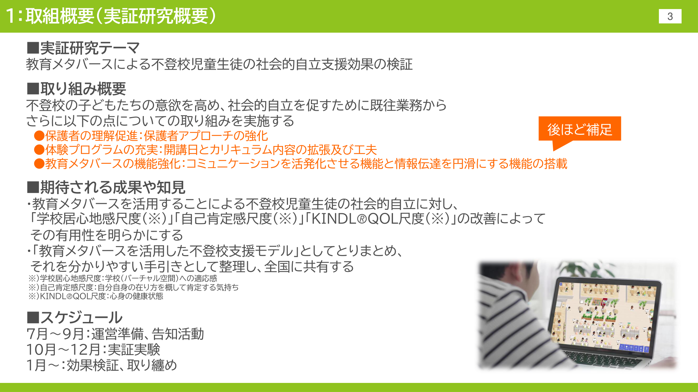

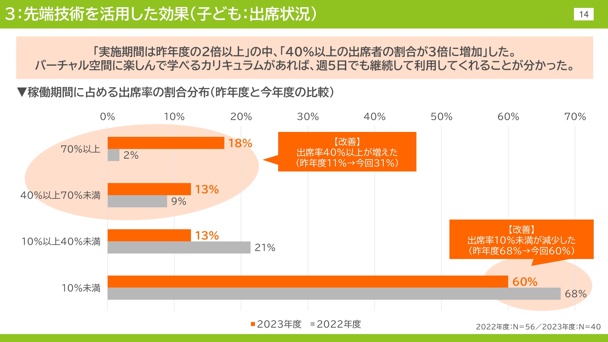

- After a more fun, game-like curriculum was added, the share of students attending at least 40% of days **rose from 11% to 31%**.
- The report concludes: *"With a curriculum where children can enjoy learning in the virtual space, they will keep using it even 5 days a week."*
- **However, only 15% of the city's futoukou students signed up.** Reaching the children is still the bottleneck.

**Pitch line:** *"Virtual spaces work for futoukou students, but only 15% signed up. Kokoro starts earlier, with the belongings every child already carries, before they stop coming to school."*

---

## Part B: Gamification

### B1. Which game elements actually work in mental health apps

**Cheng VWS, Davenport T, Johnson D, Vella K, Hickie IB (2019).** *Gamification in Apps and Technologies for Improving Mental Health and Well-Being: Systematic Review.* JMIR Mental Health 6(6):e13717. [PMC6617915](https://pmc.ncbi.nlm.nih.gov/articles/PMC6617915/)

- The review covers **70 papers and 50 apps**.
- The most common elements were **levels and progress feedback, points, rewards, narrative or theme, personalization, and customization**.

**How Kokoro uses each element:**

| Game element | Kokoro feature |
|---|---|
| Levels and progress | Companions **grow** with care (the tsukumogami idea) |
| Narrative and theme | The tsukumogami story and the nightly council |
| Personalization | Companions are **your own** belongings |
| Customization | The child chooses each companion's personality |
| Rewards | Companions celebrate when the child reaches out for help |

---

### B2. 🇯🇵 Gamified CBT adapted for Japan, with a culturally redesigned character

**Yokomitsu K, Irie T, Sekiguchi M, et al. (2020).** *Gamified Mobile Computerized Cognitive Behavioral Therapy for Japanese University Students With Depressive Symptoms: Protocol for a Randomized Controlled Trial.* JMIR Research Protocols 9(4):e15164. [PMC7175183](https://pmc.ncbi.nlm.nih.gov/articles/PMC7175183/)

*Figure 2 from the paper: the guide character in the original New Zealand version (left) and the Japanese version (right).*

- SPARX is a fantasy game that teaches CBT across 7 modules. In New Zealand it was **as effective as usual care** for adolescents with mild-to-moderate depression.
- For Japan, the team **redesigned the guide character**.
- ⚠ This is a trial *protocol*. I couldn't find a published Japanese results paper, so cite it for the cultural-adaptation design, not for outcomes.

**Pitch line:** *"Even proven Western games had to redesign their characters for Japanese users. Kokoro starts from Japanese culture, with tsukumogami."*

---

## Part C: Turning belongings into companions

### C1. Photograph an object → AI gives it a personality → it talks to you

**Mykhaylychenko D, Thasin M, Baradari D, Mhungu C (2025).** *A(I)nimism: Re-enchanting the World Through AI-Mediated Object Interaction.* NeurIPS 2025 Creative AI Track (MIT / MIT Media Lab). [arXiv:2509.25558](https://arxiv.org/abs/2509.25558)

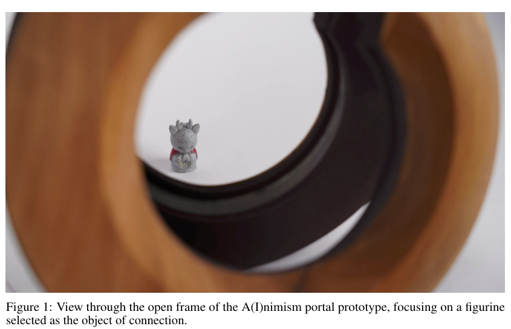

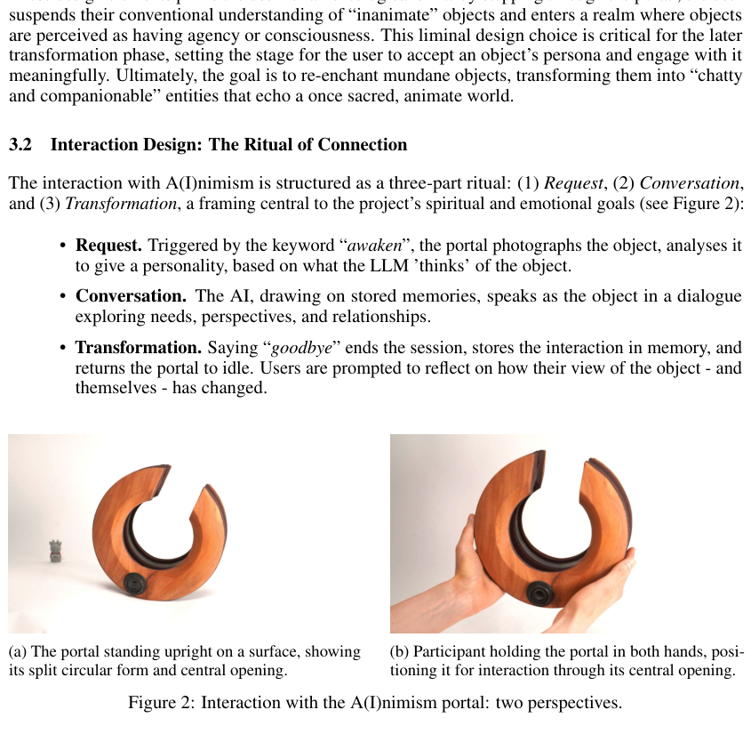

- **"The portal photographs the object, analyses it to give a personality… The AI, drawing on stored memories, speaks as the object."**
- The design draws on **Japanese torii gates and Shinto ideas**, and calls itself "techno-animism".
- ⚠ This is an art and design prototype, not a clinical study. It shows the concept is technically feasible and being taken seriously at a top AI conference. It does not show health outcomes.

**Pitch line:** *"MIT researchers presented 'object personas' at NeurIPS 2025. Kokoro takes the same idea to children's own belongings and points it at a real problem: catching children's SOS."*

---

### C2. 🇯🇵 Adolescents tell a simple robot more than they tell a human

**Kumazaki H, Warren Z, Swanson A, et al. (2018).** *Can Robotic Systems Promote Self-Disclosure in Adolescents with Autism Spectrum Disorder? A Pilot Study.* Frontiers in Psychiatry 9:36. Kanazawa Univ. and Osaka Univ. (Ishiguro Lab). [doi:10.3389/fpsyt.2018.00036](https://doi.org/10.3389/fpsyt.2018.00036)

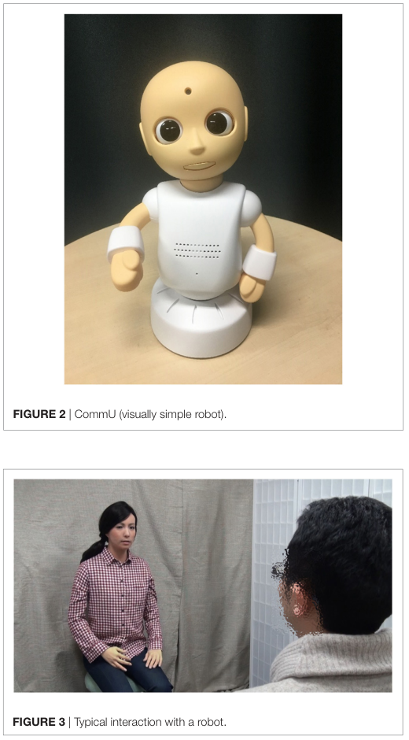

- Participants were 19 adolescents. Each one shared their *happiest, saddest and most embarrassing* moments with an android, with a **simple robot (CommU)** and with a human.
- Adolescents with ASD gave **longer disclosures to the simple robot than to the human interviewer**.
- ⚠ The sample was small and the effect was found in adolescents with ASD.

**Pitch line:** *"A Japanese study found adolescents said more to a simple, non-human character than to a person. A water bottle is about as simple and non-threatening as a character can get."*

---

### C3. Children reveal things to a robot that they don't put on questionnaires

**Abbasi NI, Spitale M, Anderson J, Ford T, Jones PB, Gunes H (2022).** *Can Robots Help in the Evaluation of Mental Wellbeing in Children? An Empirical Study.* IEEE RO-MAN 2022 (University of Cambridge). [Cambridge news release](https://www.cst.cam.ac.uk/news/robots-assessing-childrens-mental-wellbeing)

- Participants were 28 children aged 8–13, who each had a 45-minute session with a Nao robot.
- Children **shared information with the robot that they had not shared in online or in-person questionnaires**.
- The researchers said the robot's small size and non-threatening look made it feel like a confidant, so children felt *they wouldn't get into trouble*.

**Pitch line:** *"Cambridge found children tell a friendly non-human things they won't tell a form. Kokoro makes that friend something the child already owns."*

---

### C4. 🇯🇵 Children treat AR characters built in Unity as real

**Shirai N, Kondo L, Imura T (2020).** *Effects of visual information presented by augmented reality on children's behavior.* Scientific Reports 10:6832. Niigata University and Japan Women's University. [PMC7176651](https://pmc.ncbi.nlm.nih.gov/articles/PMC7176651/)

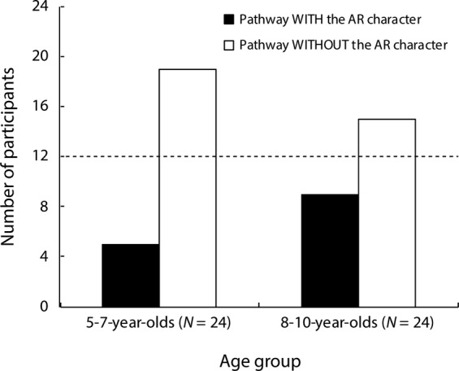
*Children aged 5–7 and 8–10 avoided the path where an AR character stood. Adults showed no such bias.*

- **Built with the Unity 3D game engine and the Vuforia AR library, running on an iPad.**
- After seeing an "invisible friend" through the tablet, **children changed how they moved in the real room**. Adults did not.
- The authors link this to how children relate to *imaginary companions*.

**Pitch line:** *"A Japanese Unity AR study showed children treat AR characters as really present. That's why Kokoro's companions appear in AR on the child's own desk."*

---

## Part D: Machine learning. The council and early detection

### D1. Several signals combined beat a single signal

**Xu X, Chikersal P, Doryab A, et al. (2019).** *Leveraging Routine Behavior and Contextually-Filtered Features for Depression Detection among College Students.* Proc. ACM IMWUT 3(3). doi:10.1145/3351274. Carnegie Mellon and Univ. of Washington. [PDF](https://homes.cs.washington.edu/~althoff/docs/2019_IMWUT_Leveraging_Multimodal_Routine_Behavior_for_Depression_Detection_among_College_Students.pdf)

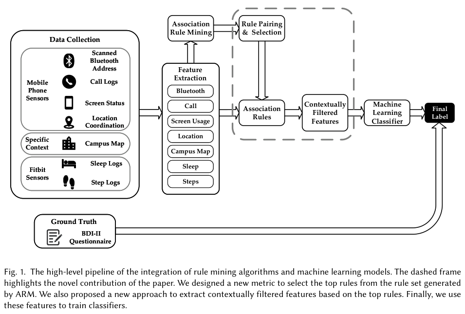

- Most earlier work used **one sensor at a time**. This study combined patterns that appear **across several signals at once**: phone use, location, sleep, steps and calls.
- **The combined model beat single-sensor models by an average of 9.7%.**
- Related work by the same group (Chikersal et al., 2021, ACM TOCHI, 138 students) used multi-source sensing to flag students whose depressive symptoms were **getting worse** over a semester.

**How it maps to Kokoro:** each companion is one "sensor" for one part of life (body, study, school, friends). The council combines them.

**Pitch line:** *"Research shows combining several signals detects depression better than one. Kokoro does that with a child's belongings: one witness is a guess, a council is a pattern."*

---

### D2. 🇯🇵 ML-backed suicide-risk screening already runs in Japanese schools

**Kitagawa Y (Principal Investigator), The University of Tokyo (2022–2025).** *Elucidating the algorithm for predicting student's suicide risk: a large-scale empirical study in primary and secondary schools across the country using the Suicide Risk Assessment Tool (RAMPS).* Japan Suicide Countermeasures Promotion Center (JSCP), R4-1-3. [Final achievement report (PDF)](https://jscp.or.jp/assets/img/irpsc_R6Achivement_R4-1-3.pdf)

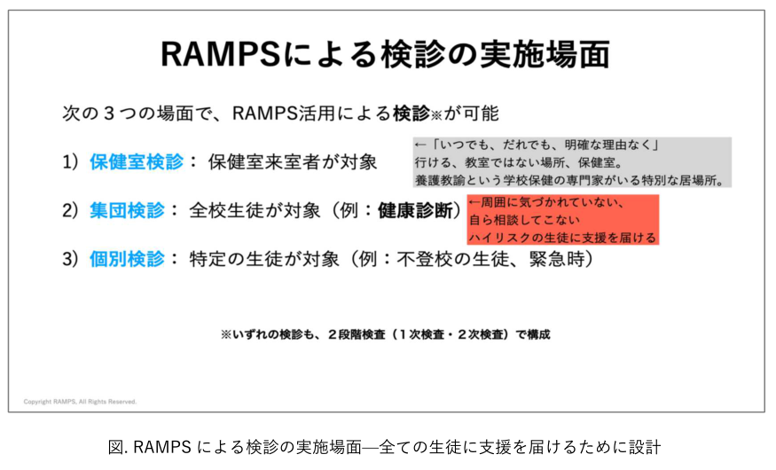
*From the report: RAMPS group screening is designed to reach "high-risk students that others haven't noticed and who don't come to ask for help on their own" (周囲に気づかれていない、自ら相談してこないハイリスクの生徒).*

- In FY2024 it ran in **about 170 junior high and high schools**, with **more than 60,000 students** using it.
- Students answer on their school tablets. The questions include **daily-life items such as habits and friendships**, alongside standard risk scales.
- The project's goal is a **machine-learning risk-prediction algorithm**. Schools reported cases where it found students at risk early.

**How Kokoro is different:** RAMPS is a **periodic questionnaire**. Kokoro gathers signals **every day, through companions the child cares about**, and adds the council cross-check. The two could work together: Kokoro's 🔴 level hands off to the same school support system.

**Pitch line:** *"Japan already trusts tablet-based, ML-backed screening in 170 schools. Kokoro makes it daily and friendly instead of a once-a-term survey."*

---

### D3. 🇯🇵 AI that predicts truancy is already being piloted by a city

**Toda City Board of Education, with PKSHA Technology and Uchida Yoko (2023–2024).** A Children and Families Agency data-linking pilot. Sources: [PKSHA / Uchida Yoko press release](https://resemom.jp/release/prtimes/20231215/108528.html) · [Toyo Keizai](https://toyokeizai.net/articles/-/761493) · [Kyodo via Bernama](https://bernama.com/tv/news.php?id=2329779)

- An AI calculates a **futoukou risk score** from **attendance, nurse's office visits and academic test results**, and shows which data items drove the score.
- It started at a pilot school in November 2023 and expanded to **18 schools**. Toyo Keizai reported that **about 90% of schools rated it reliable**.
- ⚠ These are news and press sources, not a peer-reviewed paper.

**How Kokoro is different:** Toda's AI only sees **records** like absences and nurse visits, which appear after the child is already struggling. Kokoro adds **the child's own voice, every day**, before it shows up in attendance.

---

## Part E: Unity. AR companions and VR rehearsal

### E1. 🇯🇵 A metaverse built in Unity: avatars reduce anxiety and stigma

**Hasei J, Ishida H, Katayama H, et al. (2024).** *Utilizing the Metaverse to Provide Innovative Psychosocial Support for Pediatric, Adolescent, and Young Adult Patients with Rare Cancer.* Cancers 16(15):2617. Okayama University. [PMC11311008](https://pmc.ncbi.nlm.nih.gov/articles/PMC11311008/)

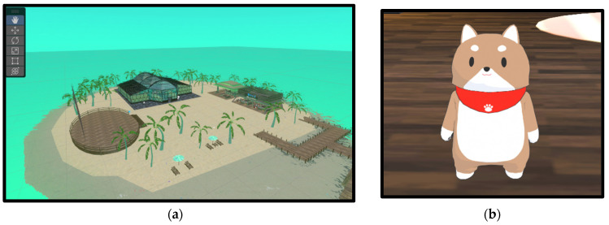

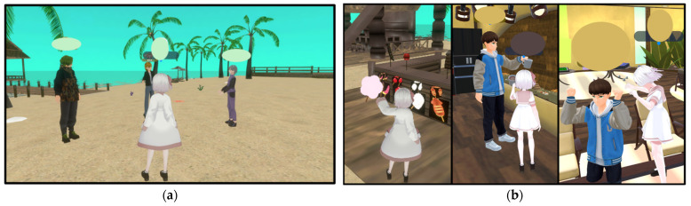

- **"The virtual environment was developed using Unity as a world within 'cluster'"**, a Japanese metaverse platform (Cluster, Inc., Tokyo).
- Participants were 10 young patients from 4 regions of Japan. The metaverse let them **connect with peers and receive emotional support**.
- **Avatar anonymity reduced appearance-related anxiety and stigma.**

---

### E2. VR rehearsal built in Unity works for adolescents (randomized controlled trial)

**Azimisefat P, Ravanbod S, de Jongh A, et al. (2026).** *Virtual Reality Exposure-Enhanced CBT vs. CBT With Imaginal Exposure for Adolescent Social Anxiety Disorder: A Pilot Randomized Controlled Trial.* Depression and Anxiety. doi:10.1155/da/9956436. [PMC13201251](https://pmc.ncbi.nlm.nih.gov/articles/PMC13201251/)

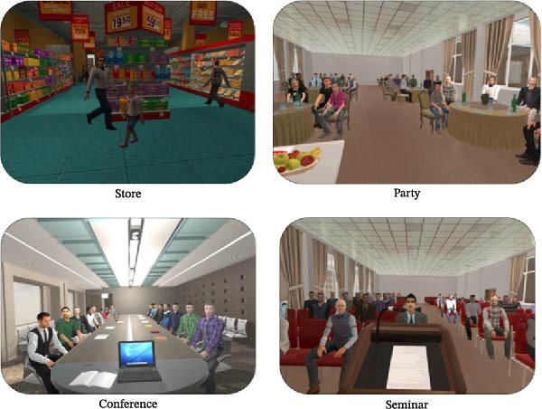
*The VR scenarios (store, party, conference, seminar) were **developed using the Unity platform**.*

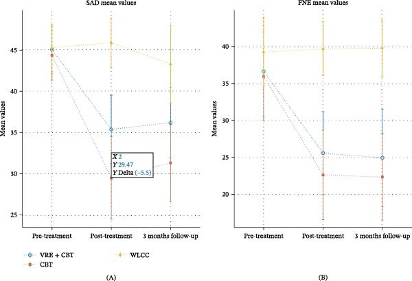

- **51 adolescents** with social anxiety disorder (average age about 16) took part in a 3-arm RCT.
- CBT + VR exposure **reduced social anxiety (d = 1.31) and fear of negative evaluation (d = 1.35)** compared with a waitlist. **The gains lasted at 3-month follow-up.**
- ⚠ Be honest if asked: CBT with *imagined* exposure did even better on social anxiety symptoms. VR helps, but it isn't magic. Kokoro uses VR as **gentle practice**, not as therapy.

**Pitch line:** *"A randomized trial with adolescents showed that practice scenes built in Unity reduce social anxiety, and the effect lasts. Kokoro's VR rehearsal uses the same approach for the moment of asking for help."*

---

### E3. 🇯🇵 NHK's social VR program helped Japanese teens open up

**Fujita J, Takayama M, Kamono E, et al. (2025).** *Insights From NHK's Virtual Reality-Based Social Interaction Television Program "Project Aliens" for Adolescents With Psychiatric Disorders: Single-Center Case Series Study.* JMIR Formative Research 9:e74401. [PMC12166319](https://pmc.ncbi.nlm.nih.gov/articles/PMC12166319/)

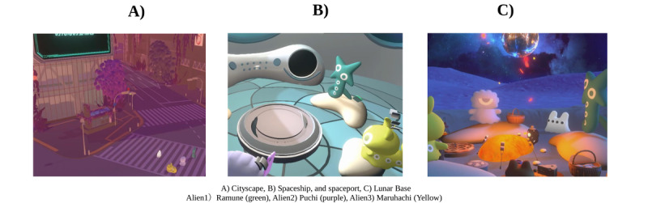

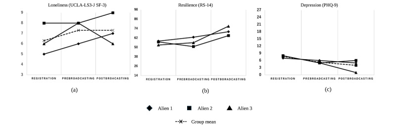

- Adolescents took part as **cute alien avatars** in a story-driven VR journey: city → spaceship → moon base.
- Their **loneliness, resilience and depression (PHQ-9) scores all improved**. The structured activities helped them **express both positive and negative emotions**.
- ⚠ Only 3 participants, so this is early evidence.

**Pitch line:** *"Japan's public broadcaster has already shown that cute, non-human avatars help Japanese teens open up in VR. Kokoro's companions work on the same principle."*

---

### E4. 🇯🇵 (Optional) VR social-skills training is feasible in Japanese clinical care

**Akaki Y, Nakamura Y, Nakanishi Y, Okuyama Y, Fujita K (2026).** *Embedding virtual reality social skills training into return-to-work care for depression: A single-arm feasibility pilot.* PCN Reports. [PMC12862656](https://pmc.ncbi.nlm.nih.gov/articles/PMC12862656/)

- 20 adults with depression attended **94.2% of sessions with no dropouts**, and social skills scores improved (KiSS-18, p = 0.028).
- This shows **people stick with VR practice** in Japanese settings. ⚠ The participants were adults, not students.

---

## Part F: Putting it on one pitch slide

### "Built on evidence" slide (4 boxes)

| 🧸 **Objects as friends** | 🧠 **The council** | 🎮 **Gamified ritual** | 🥽 **Unity AR/VR** |
|---|---|---|---|
| Teens disclose more to simple non-human characters *(Kumazaki 2018 🇯🇵; Cambridge 2022)* | Multiple signals beat one by 9.7% *(Xu 2019)*. ML screening runs in 170 Japanese schools *(RAMPS 🇯🇵)* | A chatbot alone lost every teen enrolled *(emol RCT 🇯🇵)*. A fun curriculum nearly tripled attendance *(MEXT metaverse 🇯🇵)* | Unity VR rehearsal reduced teen social anxiety, d = 1.31 *(RCT 2026)*. Children treat Unity AR characters as real *(Niigata 🇯🇵)* |

### Evidence mapped to the solution flow

| Solution step | Evidence to quote |
|---|---|
| ① 出会い Summon | A(I)nimism (NeurIPS 2025), Unity AR (Niigata 2020) |
| ② 日常 Ritual | Gamification review (Cheng 2019), SPARX Japan, emol termination report |
| ③ 気づき Share | Kumazaki 2018, Cambridge 2022 |
| ④ 会議 Council | Xu 2019, RAMPS, Toda City AI |
| ⑤ 寄り添い Respond | RAMPS (school hand-off to counselors) |
| ⑥ 練習 Rehearse | Unity VR RCT 2026, NHK Project Aliens, Okayama Unity metaverse |
| ⑦ 見守り Watch over | Toda City AI (shows the data behind each risk score), RAMPS |
| 🔁 Loop / ibasho | MEXT Koganei metaverse attendance |

---

## ⚠ Don't overclaim

1. **Most studies are small or pilots.** Say *"research suggests"* or *"studies show"*, not *"proven"*.
2. **No study tests Kokoro's exact idea** of belongings as companions that cross-check each other. That's your novelty. Present the research as backing **each building block**, not the whole system.
3. **Don't cite "Unmasking Suppressed Emotion".** The earlier competitor analysis mentioned this paper, but I couldn't find it on arXiv or in search. It may not exist.
4. **SPARX Japan** is a protocol, and **A(I)nimism** is a design prototype. Cite them for design, not outcomes.
5. **Toda City** figures come from press and news, not a peer-reviewed paper.

---

## Full reference list

1. Fujita J, et al. (2025). Challenges in Implementing a Mobile AI Chatbot Intervention for Depression Among Youth on Psychiatric Waiting Lists. *JMIRx Med.* https://doi.org/10.2196/70960
2. MEXT / Koganei City / Fuji Soft (2024). 教育メタバースによる不登校児童生徒の社会的自立支援効果の検証 成果報告. https://www.mext.go.jp/content/20240304-mxt_shuukyo02-000027064_07.pdf
3. Cheng VWS, et al. (2019). Gamification in Apps and Technologies for Improving Mental Health and Well-Being: Systematic Review. *JMIR Ment Health* 6(6):e13717. https://pmc.ncbi.nlm.nih.gov/articles/PMC6617915/
4. Yokomitsu K, et al. (2020). Gamified Mobile cCBT for Japanese University Students With Depressive Symptoms: RCT Protocol. *JMIR Res Protoc* 9(4):e15164. https://pmc.ncbi.nlm.nih.gov/articles/PMC7175183/
5. Mykhaylychenko D, et al. (2025). A(I)nimism: Re-enchanting the World Through AI-Mediated Object Interaction. *NeurIPS 2025 Creative AI.* https://arxiv.org/abs/2509.25558
6. Kumazaki H, et al. (2018). Can Robotic Systems Promote Self-Disclosure in Adolescents with ASD? *Front Psychiatry* 9:36. https://doi.org/10.3389/fpsyt.2018.00036
7. Abbasi NI, et al. (2022). Can Robots Help in the Evaluation of Mental Wellbeing in Children? *IEEE RO-MAN 2022.* https://www.cst.cam.ac.uk/news/robots-assessing-childrens-mental-wellbeing
8. Shirai N, Kondo L, Imura T. Effects of visual information presented by augmented reality on children's behavior (2020). *Sci Rep* 10:6832. https://pmc.ncbi.nlm.nih.gov/articles/PMC7176651/
9. Xu X, et al. (2019). Leveraging Routine Behavior and Contextually-Filtered Features for Depression Detection among College Students. *Proc ACM IMWUT* 3(3). https://doi.org/10.1145/3351274 · https://homes.cs.washington.edu/~althoff/docs/2019_IMWUT_Leveraging_Multimodal_Routine_Behavior_for_Depression_Detection_among_College_Students.pdf
10. Chikersal P, et al. (2021). Detecting Depression and Predicting its Onset Using Longitudinal Symptoms Captured by Passive Sensing. *ACM TOCHI* 28(1):3.
11. Kitagawa Y, et al. (2022–2025). RAMPS large-scale school study, JSCP R4-1-3. https://jscp.or.jp/assets/img/irpsc_R6Achivement_R4-1-3.pdf
12. Toda City × PKSHA × Uchida Yoko (2023). AI futoukou prediction pilot. https://resemom.jp/release/prtimes/20231215/108528.html · https://toyokeizai.net/articles/-/761493
13. Hasei J, et al. Utilizing the Metaverse to Provide Psychosocial Support for Pediatric and AYA Patients with Rare Cancer (2024). *Cancers* 16(15):2617. https://pmc.ncbi.nlm.nih.gov/articles/PMC11311008/
14. Azimisefat P, et al. CBT + VR Exposure vs CBT + Imaginal Exposure for Adolescent Social Anxiety Disorder: Pilot RCT (2026). *Depress Anxiety.* https://pmc.ncbi.nlm.nih.gov/articles/PMC13201251/
15. Fujita J, et al. (2025). NHK "Project Aliens" social VR case series. *JMIR Form Res* 9:e74401. https://pmc.ncbi.nlm.nih.gov/articles/PMC12166319/
16. Akaki Y, et al. (2026). VR social skills training in return-to-work care for depression. *PCN Reports.* https://pmc.ncbi.nlm.nih.gov/articles/PMC12862656/

*Figures are reproduced from the open-access papers and public reports listed above, for presentation and citation only. Credit the source on any slide where you use one.*
